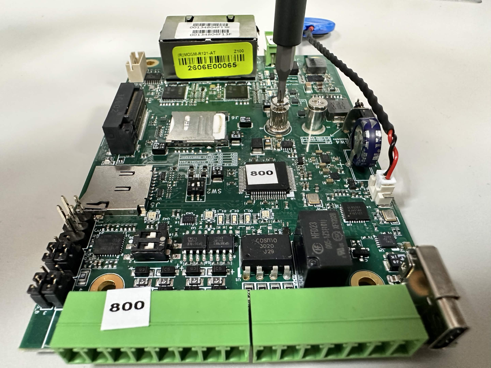
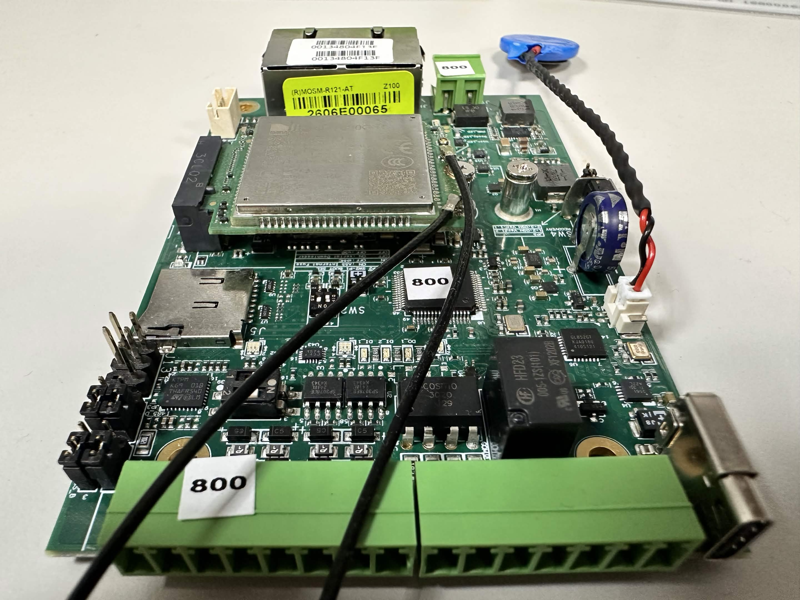

# LTE Module Guide

The **Matrix-800** is equipped with a built-in **M.2 B-Key expansion slot** designed specifically for wireless and cellular connectivity. This allows easy integration of 4G LTE modules such as the [**SIM7600X-H-M2**](https://www.simcom.com/product/SIM7600X-H-M2.html), enabling the device to connect to cellular networks for remote monitoring, data transmission, and IoT applications.

This guide covers the hardware installation and software configuration required to activate the **SIM7600X-H-M2** LTE module on the **Matrix-800**.


## Hardware Requirements

- Matrix-800
- SIM7600X-H-M2
- Micro-SIM Card
- Wideband 4G/LTE Antennas

## Hardware Guide

<p float="left">
    
    
</p>

1. Insert the Micro-SIM card into the Micro-SIM card socket.
2. Remove the screw next to the Micro-SIM card socket.
3. Attach the LTE module onto the M.2 connector.
4. Reinstall the screw to secure the LTE module.
5. Attach 2 antennas onto `MAIN` and `AUX` connectors.

> [!TIP]
> The antenna on `MAIN` connector is **mandatory**, while the one on `AUX` connector is **optional**. However, It is still highly recommended to use both antennas to ensure bandwidth stability and signal quality.

## Software Guide

### Step 1 — Preparations

**Login as `root`**
```console
guest@matrix800:~$ su -
Password: root
root@matrix800:~# 
```

**Install required packages**
```console
root@matrix800:~# apt -y install usbutils udhcpc
```

**Power on the M.2 module (wait until M.2 module blinks)**
```console
root@matrix800:~# gpioset -c gpiochip7 -t0 0=1
```

**Check module detection**
```console
root@matrix800:~# lsusb
Bus 001 Device 002: ID 1e0e:9001 Qualcomm / Option SimTech, Incorporated
```
```console
root@matrix800:~# dmesg | grep 'GSM modem'
[ 1254.614058] usbserial: USB Serial support registered for GSM modem (1-port)
[ 1254.614576] option 1-1:1.0: GSM modem (1-port) converter detected
[ 1254.617600] usb 1-1: GSM modem (1-port) converter now attached to ttyUSB4
[ 1254.619248] option 1-1:1.1: GSM modem (1-port) converter detected
[ 1254.621645] usb 1-1: GSM modem (1-port) converter now attached to ttyUSB5
[ 1254.623954] option 1-1:1.2: GSM modem (1-port) converter detected
[ 1254.629294] usb 1-1: GSM modem (1-port) converter now attached to ttyUSB6
[ 1254.629570] option 1-1:1.3: GSM modem (1-port) converter detected
[ 1254.630323] usb 1-1: GSM modem (1-port) converter now attached to ttyUSB7
[ 1254.634123] option 1-1:1.4: GSM modem (1-port) converter detected
[ 1254.634489] usb 1-1: GSM modem (1-port) converter now attached to ttyUSB8
```

**Find Interface Name**

```console
root@matrix800:~# ip link
1: lo: <LOOPBACK,UP,LOWER_UP> mtu 65536 qdisc noqueue state UNKNOWN mode DEFAULT group default qlen 1000
    link/loopback 00:00:00:00:00:00 brd 00:00:00:00:00:00
2: end1: <BROADCAST,MULTICAST,UP,LOWER_UP> mtu 1500 qdisc mq state UP mode DEFAULT group default qlen 1000
    link/ether 00:13:48:04:fe:13 brd ff:ff:ff:ff:ff:ff
    altname enx00134804fe13
3: end0: <NO-CARRIER,BROADCAST,MULTICAST,UP> mtu 1500 qdisc mq state DOWN mode DEFAULT group default qlen 1000
    link/ether 00:13:48:04:fe:12 brd ff:ff:ff:ff:ff:ff
    altname enx00134804fe12
4: docker0: <NO-CARRIER,BROADCAST,MULTICAST,UP> mtu 1500 qdisc noqueue state DOWN mode DEFAULT group default
    link/ether 36:48:7e:2d:50:55 brd ff:ff:ff:ff:ff:ff
7: wwu1i5: <BROADCAST,MULTICAST> mtu 1500 qdisc noop state DOWN mode DEFAULT group default qlen 1000
    link/ether 8e:77:7b:0b:2c:e5 brd ff:ff:ff:ff:ff:ff
```

> [!TIP]
> Find the last index, usually the interface is named `wwu1i5`. If a different name showed up, use that instead for upcoming steps.


### Step 2 — Activations

**Dial-up**
```
ifconfig wwu1i5 up
echo -e "AT\$QCRMCALL=1,1\r" > /dev/ttyUSB6
udhcpc -i wwu1i5
```

> [!TIP]
> `ttyUSB6` is typically the correct port for the dial-up command. Try `ttyUSB5` or `ttyUSB7` if it doesn't respond.


### Step 3 — Verifications

**Check IP address and status**
```
ip addr show wwu1i5
```

**Check default route**
```
ip route | grep default
```

**Test basic IP connectivity**
```
ping -I wwu1i5 8.8.8.8 -c 4
```

**Test DNS resolution**
```
ping -I wwu1i5 google.com -c 4
```
